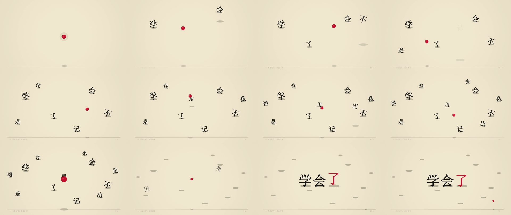

# 代码动效 Playbook

**给 AI 用的动效生产规格。** 不是风格词表，是能照着做完一支片子的工作流。

> 341 份动效提示词全量精读后提炼，并**用一支实际渲染的成片验证过**。
> 你（或你的 AI）读完 `SKILL.md` 就能开工，不需要再问别人。



*示例：12 秒，24 fps，288 帧。每秒一帧，从"乱"到"落定"。*

---

## 为什么需要这个

市面上给 AI 的动效提示词，99% 是**风格关键词**：

> "赛博朋克风格，霓虹，暗色调，电影感"

这类东西的产出永远是"大概像，但不对劲"。因为：

- 它没说**帧率**
- 它没说**缓动曲线**
- 它没说**什么不许动**
- 它没说**重量感从哪来**
- 它没说**怎么验收**

结果就是：AI 给你一段"能跑，但看着廉价"的动画。

**动效的本质是可执行规格，不是美学描述。**

这个 playbook 把"美学描述"翻译成了"参数"。

---

## 30 秒上手

### 如果你是人

把这句话发给你的 AI：

```
读 https://github.com/{{你的用户名}}/motion-playbook 的 SKILL.md，
然后照里面的工作流，做一支 10 秒动效，题材是「一句话被拆开又重新落定」。
先给我 8 张关键静帧看构图，我满意了你再做动画。
```

### 如果你是 AI

1. 读 [`SKILL.md`](SKILL.md) —— 完整生产规格（帧率、缓动、锚点、质感、节奏、验收）
2. 读 [`structures.md`](structures.md) —— 挑一个叙事骨架（**别跳过这步**）
3. 用 [`templates/PROMPTS.md`](templates/PROMPTS.md) 里的模板开工
4. 参考 [`examples/example-12s.html`](examples/example-12s.html) 的代码结构
5. 用 [`templates/render_anim.py`](templates/render_anim.py) 渲染成 MP4
6. 按 `SKILL.md` §14 做 7 维自评，交付时附三个最弱的地方

---

## 里面有什么

| 文件 | 是什么 | 什么时候看 |
|---|---|---|
| [`SKILL.md`](SKILL.md) | **主文件**。生产规格：帧率三轨、缓动曲线表、动作三段式、锚点、伴随现象、质感、颜色、文字、节奏表、转场、声音、六步工作流、7 维自评、交付清单、失败模式对照 | 开工前通读一遍 |
| [`structures.md`](structures.md) | 12 个叙事骨架（情绪弧线 / 一元素串全片 / 五幕 / 四段式 / 原理拆解 / 时间线 / 配方式 / 尺度拉远 / 一镜到底 / 一形状变到底 / 文字建筑 / 破框） | **动笔前先选一个** |
| [`templates/PROMPTS.md`](templates/PROMPTS.md) | 5 个即用提示词模板（通用 / 竖屏 / 只做关键帧 / 只审片 / 反向工程参考图） | 想直接开工时 |
| [`templates/render_anim.py`](templates/render_anim.py) | 已验证的逐帧渲染脚本（CDP + ffmpeg） | 要出 MP4 时 |
| [`templates/check_anim.py`](templates/check_anim.py) | 截指定时间点的帧 + 确定性检查 | 检查画面时 |
| [`examples/example-12s.html`](examples/example-12s.html) | 一支完整成片的源码（12 秒，288 帧） | 想知道"具体怎么写"时 |
| [`CHEATSHEET.md`](CHEATSHEET.md) | 一页速查表 | 已经会了，只想查参数 |
| [`sources/`](sources/) | **17 份引用原文节选**（不是全量）。每份对应正文里的一条结论，用来核对我说得对不对 | 想验证某条结论时 |

---

## 三条最反直觉的结论

### 1. 抽帧只抽"被画的东西"，绝不抽"看的东西"

```js
const tChar = Math.floor(t * 12) / 12;  // 角色：一拍二 → 手作感
const tCam  = t;                         // 摄影机：每帧 → 否则就是"抖"
```

所有元素用同一个帧率，是画面"平"的最大来源。

### 2. "什么不动"比"什么动"更重要

先列 2–3 个绝对不能动的锚点（坐标系 / 已落定物 / 摄影机关系），再谈动。
**已经落定的东西不许再动** —— 这是"稳重"和"乱"的分界线。

### 3. 没有普世的禁令，只有风格内的语法

"禁 dissolve" 是实拍/新闻类的规则；电影预告片类**全程 dissolve 不许硬切**。
判断标准只有一条：**这个转场有因果吗？**
（转场要由画面里的某个东西带动，不是纯透明度交叉。）

---

## 环境要求

- **渲染**：Node（可选）+ Edge/Chrome + ffmpeg + Python 3.9+
- **Python 依赖**：`pip install websocket-client`
- **ffmpeg**：需要能编码 H.264 / AAC

快速验证：

```bash
python templates/render_anim.py \
  --html examples/example-12s.html \
  --out out.mp4 --duration 12 --fps 24
```

---

## 为什么只放 17 份原文，不放 341 份

正文里每条结论，大部分不需要原文就能懂——"抽帧只抽被画的"这句话本身就够清楚。

但有 17 处，**不看原文你没法判断我说得对不对**：要么是我把一句话总结成了规则，
要么是我在反驳一个常见误解（比如我说"禁 dissolve"，但有一份明确规定全程 dissolve）。

所以 [`sources/`](sources/) 只放这 17 份，每份只保留支撑结论的那几段，并在文件头写明
**"为什么收录"**。[`sources/README.md`](sources/README.md) 是一张对照表：哪份文件支撑哪条结论。

全量 341 份请去原仓库。**不收全量是因为那是别人的仓库，去那里取才是正路**，
而且 196 张配图 + 60MB 示例视频会显著拖慢 clone。

---

## 来源与许可

见 [`ATTRIBUTION.md`](ATTRIBUTION.md)。

**简短版**：本仓库的方法论是原创整理；知识来源是开源社区的 341 份动效提示词合集
（[XiaoyeCodes/code-animation-prompts](https://github.com/XiaoyeCodes/code-animation-prompts)）。
`sources/` 里的 17 份节选保留原署名与原许可（含三份第三方 MIT）。
原素材约定「免费分享、禁止包装成课程或付费 skill 出售」，本仓库遵守该约定：
**完全免费，不用于任何收费产品**。

本仓库自己的文字与代码：MIT。
