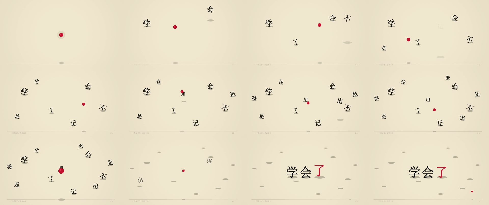
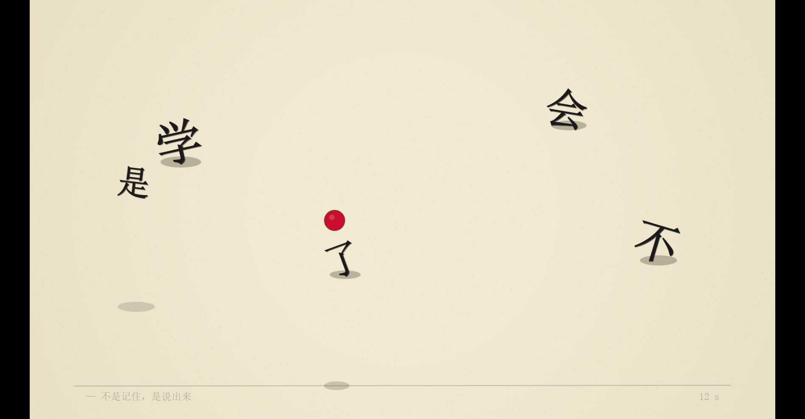
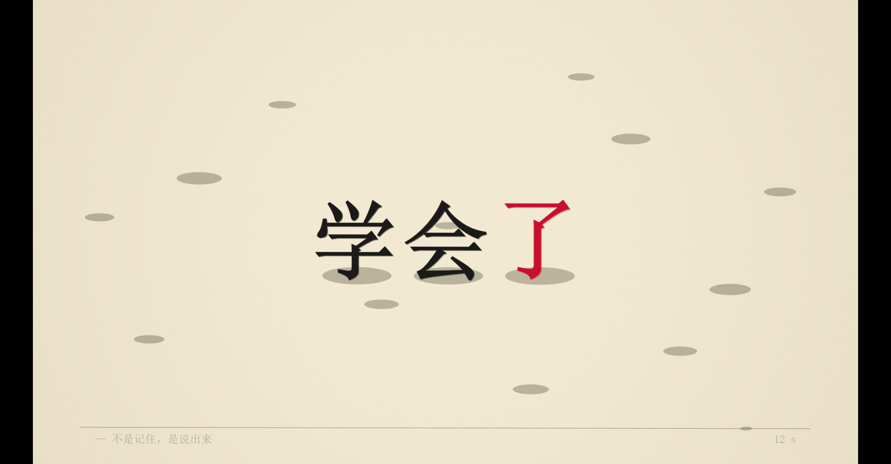

# 示例：12 秒成片

`example-12s.html` 是一支完整成片的源码，用来演示 [SKILL.md](../SKILL.md) 的规格怎么落地。

## 成片预览



*每秒一帧，12 格：乱字落下 → 第 9 秒被扫开只剩影子 → 「学会了」落定*

| 3 秒（乱） | 10.5 秒（落定） |
|---|---|
|  |  |

## 它是什么

**题材**：一句话被拆开、又重新落定。

**决策链**（严格按 SKILL.md §13 走）：

| 步 | 决策 |
|---|---|
| 本质 | 一句话被拆开又重新落定 —— 不是"一段炫酷的粒子动画" |
| 结构 | `structures.md` 的 **B（一个元素串全片）** + **A（情绪弧线：乱→理→清）** |
| 物质/信息 | 物质（纸 + 墨 + 一枚实体圆点）→ **24 fps** |
| 锚点 | 纸面（永不动）、地平线、已经落定的字 |
| 曲线 | `inertia(u,1.7,3.4)`（b>a 惯性）；落字 1 帧过冲 `1.15×`；呼吸 `cos(2π·beats)` |
| 伴随现象 | 每个字落下时影子同时收紧 + 纸面压出凹痕 + 落定后微弹一次 |
| 节奏 | 0.5s hook（圆点砸进纸面）/ 9s 英雄时刻（字被一个动作扫开）/ 结尾定格 + 呼吸 |

## 技法对照（每条都能指出来源）

| 技法 | 在代码里 | 对应规格 |
|---|---|---|
| 混合帧率 | `q12(t)` 只用于字，摄影机用 `t` | SKILL §2.2 |
| 纸纹缓存 | `makePaper()` 只跑一次 | SKILL §7 |
| 描边两遍 | `drawChar()` 里两次 `fillText` | SKILL §7 |
| 落字过冲 | `sqY` 的衰减余弦 | SKILL §3.4 |
| 影子收紧 | `spread`/`alpha` 随 `hgt` 变化 | SKILL §6 |
| 元素带动转场 | 9s 的 `sweep`，字被扫开只剩影子 | SKILL §11 |
| 强调色一处 | 只有最后一个「了」是朱红 | SKILL §8 |
| 确定性 | 全部 `mulberry32(seed)`，按帧号取 | SKILL §7 |

## 怎么跑

```bash
# 浏览器里直接看（空格暂停）
start example-12s.html

# 渲染成 MP4
python ../templates/render_anim.py \
  --html example-12s.html --out out.mp4 --duration 12 --fps 24
```

输出：1920×1080，24 fps，288 帧，12.000 秒。

## 自查

```bash
python ../templates/check_anim.py \
  --html example-12s.html \
  --times 0.5,3.0,6.0,9.2,11.9 \
  --out-dir shots
```

`check_anim.py` 会顺带做确定性检查（同一个 t 画两次是否一致）。

## 已知可改进处

诚实说三个最弱的：

1. **声音完全缺失。** 按规格应该有每个落字的 click、9s 的 whoosh、结尾的落定音，并做 −14 LUFS 母带。这份示例只做了画面。
2. **中段（3–8 秒）节奏偏平。** 12 个字均匀分布，缺一个"中途的升级"。按 SKILL §10 应该每 1–2 秒有新东西，这里只是"又落了一个字"。
3. **字的位置是手写的百分比坐标，不是网格。** 随机感够，但缺一个内在的构图逻辑（比如沿某条对角线的秩序）。
